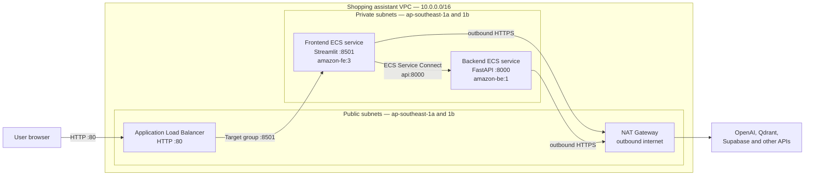
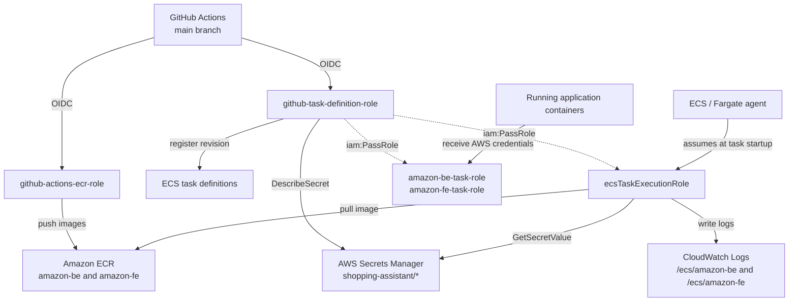

# AWS deployment architecture

This document describes the shopping assistant deployment in AWS
`ap-southeast-1`. It reflects a read-only AWS CLI inspection performed on
November 7, 2026.

## Runtime request flow

The Application Load Balancer is the only public entry point. Both Fargate
tasks run without public IP addresses. The security groups allow only these
inbound hops:

1. Internet to `alb-sg` on port 80.
2. `alb-sg` to `fe-sg` on port 8501.
3. `fe-sg` to `be-sp` on port 8000.

The frontend uses `API_URL=http://api:8000`. ECS Service Connect resolves the
`api` alias inside the private `amazon.local` namespace and routes requests to
the backend.

## Deployment and IAM role flow

### What each role does

- **`github-actions-ecr-role`** is assumed by GitHub Actions through OIDC. It
  can upload images to ECR but cannot register ECS task definitions.
- **`github-task-definition-role`** is also assumed through GitHub OIDC. It
  registers task-definition revisions, resolves secret ARNs, and passes the
  runtime roles to ECS.
- **`ecsTaskExecutionRole`** is assumed by the ECS agent. It pulls images,
  retrieves secret values before container startup, creates log groups, and
  sends container logs to CloudWatch.
- **`amazon-be-task-role`** and **`amazon-fe-task-role`** are made available to
  application code inside the containers. They currently have no permissions
  because the applications do not call AWS APIs directly.

The execution role, rather than the application task role, reads Secrets
Manager values. ECS injects those values into the backend container as
environment variables.

## Deployed resources

- ECS cluster: `shopping-assistant-cluster`
- Frontend service: `amazon-fe-service`, one Fargate task
- Backend service: `amazon-be-service`, one Fargate task
- Frontend load balancer: `shopping-assistant-fe-alb`
- Service discovery namespace: `amazon.local`
- Container images: `amazon-fe:2826bf7c` and `amazon-be:2826bf7c`
- Frontend URL:
  <http://shopping-assistant-fe-alb-1860229733.ap-southeast-1.elb.amazonaws.com/>

## Current deployment lifecycle

The GitHub Actions workflow:

1. Builds the frontend and backend images.
2. Pushes commit-tagged and `latest` images to ECR.
3. Registers new frontend and backend task-definition revisions.

It does **not** currently update the ECS services to use newly registered
revisions. After a future build, update each service manually or add
`aws ecs update-service` steps to `.github/workflows/build.yaml`.

## Recommended improvements

1. Add an ACM certificate and HTTPS listener. The current endpoint is HTTP
   only.
2. Extend CI/CD to deploy new task-definition revisions to both ECS services.
3. Add application/container health checks, especially for the backend.
4. Remove Uvicorn `--reload` from the production backend container.
5. Set CloudWatch Logs retention and enable ECR image scanning.
6. Run at least two tasks per service if high availability is required.

